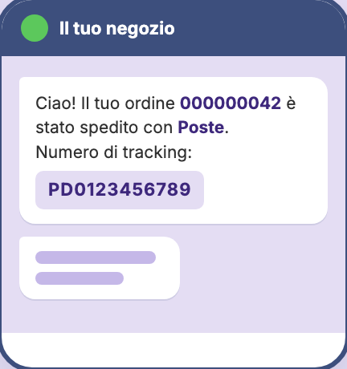
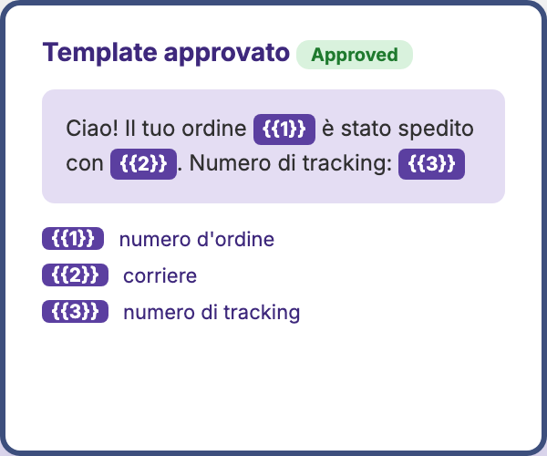
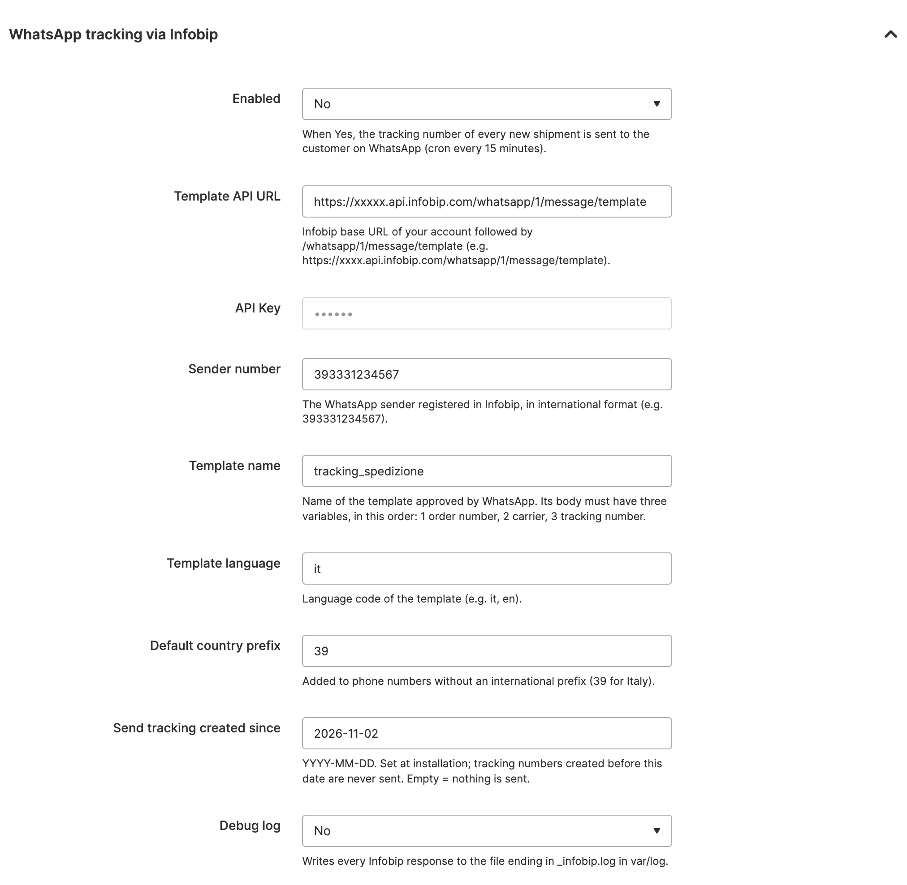

# Threecommerce_WhatsappInfobip: shipment tracking on WhatsApp for Magento 2 / Mage-OS

Sends the **tracking number of every shipment to your customer on WhatsApp**, automatically, through **Infobip** and a template approved by WhatsApp. No more "where is my parcel?" e-mails that end up in spam.

**Compatibility:** Magento Open Source / Adobe Commerce 2.4.4 – 2.4.9 · Mage-OS 1.x / 3.x · PHP 8.1 – 8.4
**License:** commercial · coming soon

## Features

- **One WhatsApp message per tracking number** added to a shipment, with **order number, carrier and tracking code**.
- Works with **any carrier**: it starts from the tracking saved in the Magento shipment, whether entered by hand or created by another module.
- Uses your own **Infobip** account and a **WhatsApp-approved template** (name and language set in the admin).
- The phone number of the shipping address is converted to **international format** (spaces, `+`, `00` and leading zero handled, default country prefix added when missing).
- Sent by **cron** every 15 minutes, with automatic retry of temporary errors and no duplicate messages.
- Configurable **per store view**: API URL, API key (stored encrypted), sender, template and language.
- **Off by default**, and tracking numbers created before the installation are never sent.

## Requirements

- Magento Open Source / Adobe Commerce 2.4.4+ or Mage-OS
- PHP 8.1 – 8.4 with `curl` and `json` extensions
- Package: `threecommerce/m2-base`
- An **Infobip** account with WhatsApp enabled: API key, a registered sender number and an approved template with three body variables (order number, carrier, tracking number)
- Magento cron running on the server

## Limitations

One message per tracking number (a shipment with several parcels sends several messages). The message contains the tracking code only, not a carrier link, and the module only sends template messages: it does not handle customer replies.

## Availability

This module is **not yet available to buy**. It is a commercial product and is coming soon. To be notified when it is released, or to ask for details, use the [product page](https://www.threecommerce.it/whatsapp-infobip-magento-2?utm_source=github&utm_medium=readme&utm_campaign=magento2-whatsapp-infobip) or [get in touch](https://www.threecommerce.it/contatti?utm_source=github&utm_medium=readme&utm_campaign=magento2-whatsapp-infobip).

## Configuration

*Stores → Configuration → Threecommerce Plugins → WhatsApp Infobip*: enable the module, Infobip template API URL and API key, sender number, template name and language, default country prefix, start date and debug log.

## Documentation and support

- Product page: [threecommerce.it/whatsapp-infobip-magento-2](https://www.threecommerce.it/whatsapp-infobip-magento-2?utm_source=github&utm_medium=readme&utm_campaign=magento2-whatsapp-infobip)
- [Changelog](CHANGELOG.md)
- Support and custom development: [threecommerce.it/contatti](https://www.threecommerce.it/contatti?utm_source=github&utm_medium=readme&utm_campaign=magento2-whatsapp-infobip)

---

*This repository is the public showcase of the module. The source code is kept in a private repository.*
